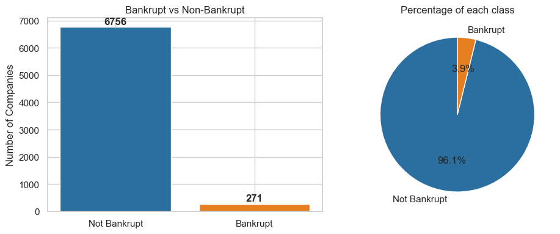
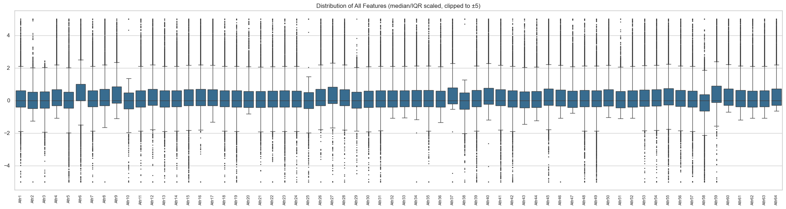
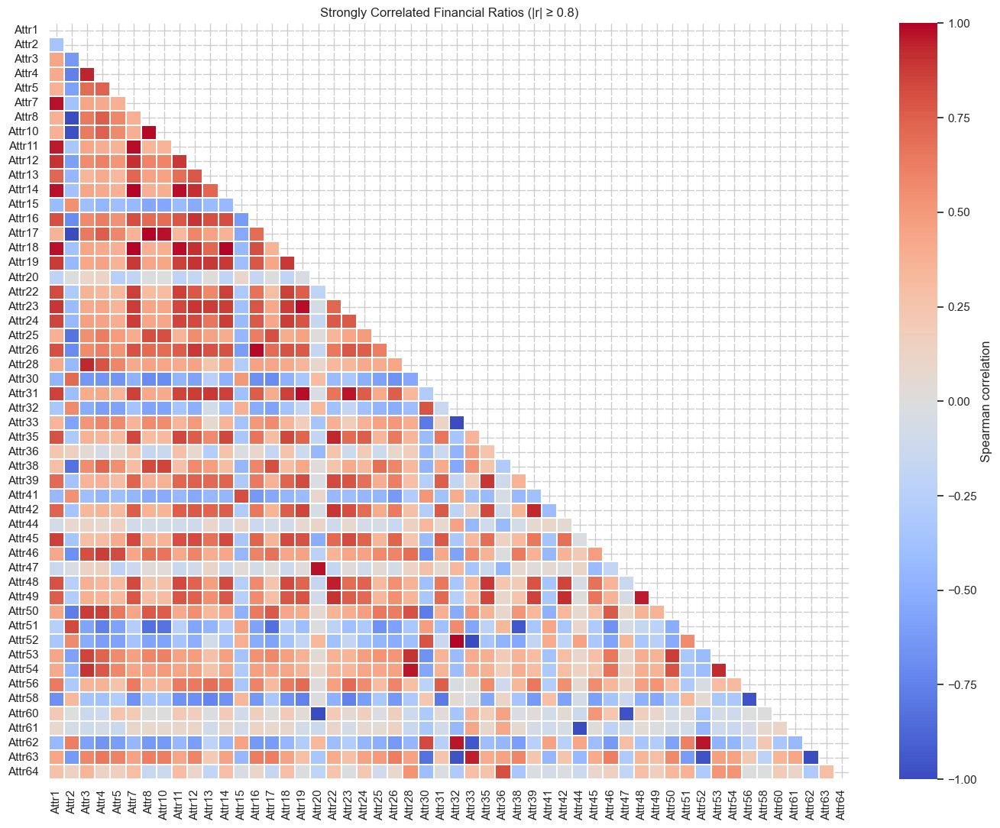
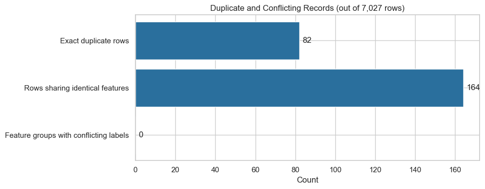
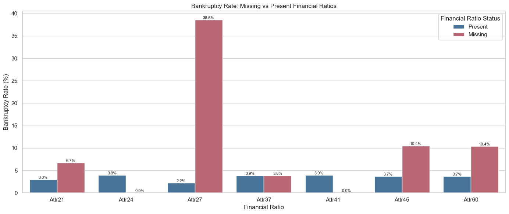
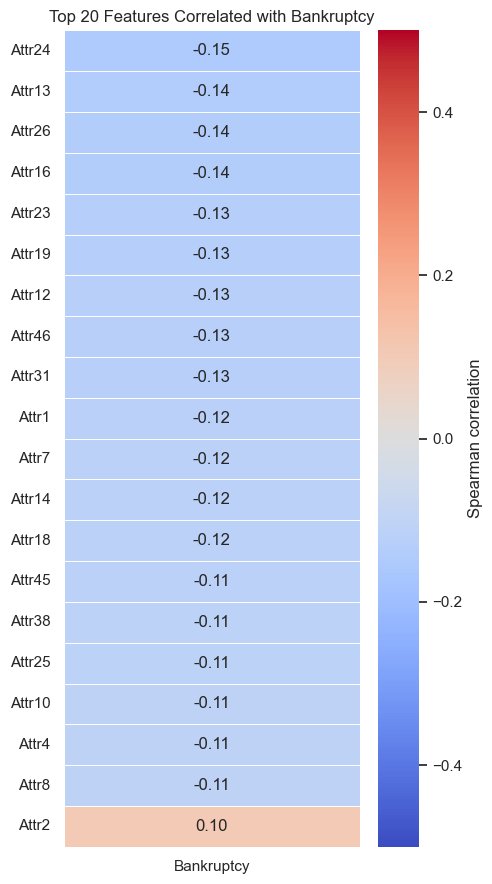
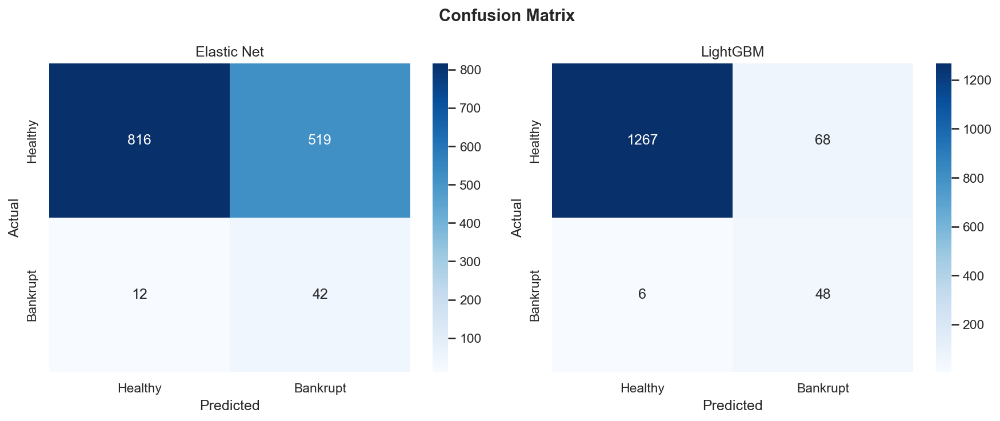
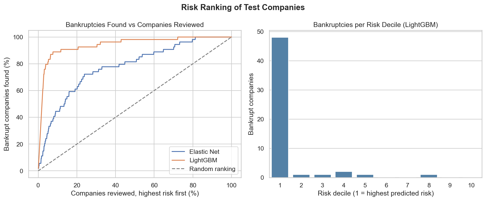
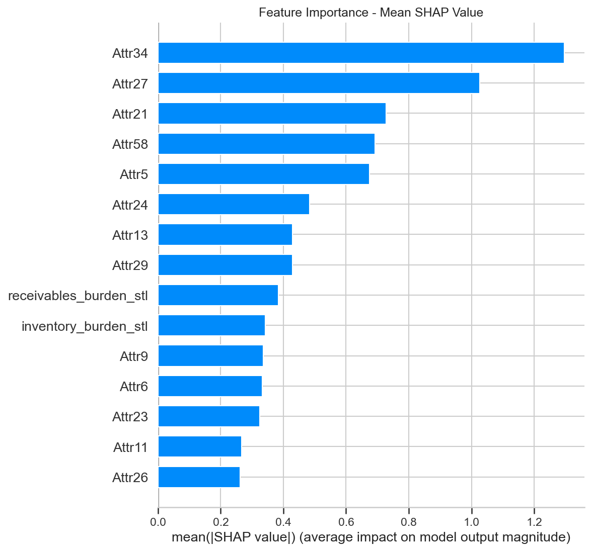
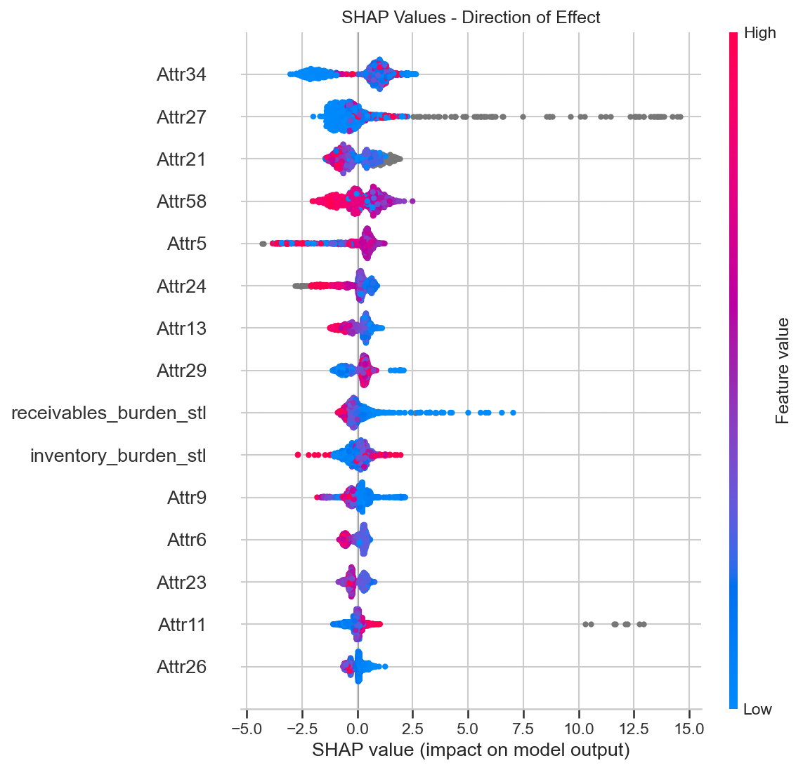

# Financial Distress Early Warning System

### End-to-End Bankruptcy Risk Prediction Pipeline

**Author:** Eegunjobi Feranmi | **Dataset:** Polish Companies Bankruptcy (UCI) | **Domain:** FinTech / Risk Analytics

---

## Overview

According to Allianz Trade's Global Insolvency Outlook (April 2026), corporate insolvencies will rise by 6% in 2026, pushing failures to a record high, 24% above pre-pandemic levels and putting 2.2 million jobs directly at risk.

Traditional manual review cannot screen every borrower in time. This project builds a machine learning pipeline that predicts bankruptcy risk from financial ratios, explains predictions using SHAP, and powers a Risk Intelligence Dashboard in Power BI. It ranks companies so analysts can investigate the riskiest ones first, achieving 88.9% recall on the held-out test set.

---

## Model Performance

| Metric | Score |
| :---: | :---: |
| PR AUC | 85.0% |
| Precision | 41.4% |
| Recall | 88.9% |
| F1 Score | 56.5% |
| Train vs Test Gap | 5.0% |
| Overfitting | None confirmed |

> LightGBM outperforms Elastic Net on PR AUC, catching 48 out of 54 failures while flagging only 116 companies, compared to Elastic Net flagging 561 companies to catch 42 failures.

---

## Project Structure

```text
financial-distress-early-warning/
│
├── 01_training/
│   ├── Plots/
│   │   ├── Confusion_matrices_for_both.png
│   │   ├── Risk_ranking.png
│   │   ├── SHAP_beeswarm_plot.png
│   │   ├── SHAP_summary_plot.png
│   │   ├── eda_01_class_imbalance.png
│   │   ├── eda_02_ratio_distribution.png
│   │   ├── eda_03_correlation.png
│   │   ├── eda_04_duplicate_and_conflicting.png
│   │   ├── eda_05_missing_vs_present_bankruptcy.png
│   │   └── eda_06_top_20_correlated_with_bankruptcy.png
│   │
│   ├── Early_Warning_Financial_Distress_Model.ipynb
│   └── high_tier_risk_reports.txt
│
├── 02_deployment/
│   ├── config.py
│   ├── deploy.py
│   ├── etl_pipeline.py
│   └── requirements.txt
│
├── 03_powerbi/
│   └── Financial-Distress-Dashboard.pdf
│
├── athena/
│   └── athena_validation.ipynb
│
├── .gitignore
└── README.md
```

---

## Dataset

### Polish Companies Bankruptcy Dataset

- **Source:** [UCI Machine Learning Repository — Polish Companies Bankruptcy Dataset](https://archive.ics.uci.edu/dataset/365/polish+companies+bankruptcy+data)
- The dataset provides five separate forecasting datasets. This project uses only the **first-year forecasting file (`1year.arff`)**.
- Contains **7,027 company observations**, including 271 bankrupt companies (3.9%) and 6,756 non-bankrupt companies (96.1%).
- Approximately 25 healthy companies for every bankrupt company.
- Financial ratios are drawn from historical company records, principally covering **2000–2013**.

### Dataset Overview

| Attribute | Description |
|---|---|
| Dataset | Polish Companies Bankruptcy |
| Source | UCI Machine Learning Repository |
| File Used | 1year.arff |
| Total Observations | 7,027 |
| Financial Features | 64 |
| Bankrupt Companies | 271 (3.9%) |
| Non-Bankrupt Companies | 6,756 (96.1%) |
| Class Distribution | Approximately 25:1 |
| Historical Period | Principally 2000–2013 |
| Target Variable | class |
| Forecasting Period | 1 year |

### Financial Attributes Description

The dataset contains 64 financial ratios representing different aspects of corporate financial performance, including profitability, liquidity, leverage, operational efficiency, and financial structure.

The table below provides the description of each financial attribute.

| Column | Description |
|---|---|
| Attr1 | Net profit / total assets |
| Attr2 | Total liabilities / total assets |
| Attr3 | Working capital / total assets |
| Attr4 | Current assets / short-term liabilities |
| Attr5 | Cash, securities and receivables less short-term liabilities, in days of operating expenses |
| Attr6 | Retained earnings / total assets |
| Attr7 | EBIT / total assets |
| Attr8 | Book value of equity / total liabilities |
| Attr9 | Sales / total assets |
| Attr10 | Equity / total assets |
| Attr11 | (Gross profit + extraordinary items + financial expenses) / total assets |
| Attr12 | Gross profit / short-term liabilities |
| Attr13 | (Gross profit + depreciation) / sales |
| Attr14 | (Gross profit + interest) / total assets |
| Attr15 | Total liabilities in days of (gross profit + depreciation) |
| Attr16 | (Gross profit + depreciation) / total liabilities |
| Attr17 | Total assets / total liabilities |
| Attr18 | Gross profit / total assets |
| Attr19 | Gross profit / sales |
| Attr20 | Inventory in days of sales |
| Attr21 | Sales growth (sales this year / sales last year) |
| Attr22 | Operating profit / total assets |
| Attr23 | Net profit / sales |
| Attr24 | Gross profit (in 3 years) / total assets |
| Attr25 | (Equity - share capital) / total assets |
| Attr26 | (Net profit + depreciation) / total liabilities |
| Attr27 | Operating profit / financial expenses |
| Attr28 | Working capital / fixed assets |
| Attr29 | Logarithm of total assets |
| Attr30 | (Total liabilities - cash) / sales |
| Attr31 | (Gross profit + interest) / sales |
| Attr32 | Current liabilities in days of cost of products sold |
| Attr33 | Operating expenses / short-term liabilities |
| Attr34 | Operating expenses / total liabilities |
| Attr35 | Profit on sales / total assets |
| Attr36 | Total sales / total assets |
| Attr37 | (Current assets - inventory) / long-term liabilities |
| Attr38 | Constant capital / total assets |
| Attr39 | Profit on sales / sales |
| Attr40 | (Current assets - inventory - receivables) / short-term liabilities |
| Attr41 | Total liabilities / annualised operating profit plus depreciation |
| Attr42 | Operating profit / sales |
| Attr43 | Receivables and inventory turnover in days |
| Attr44 | Receivables in days of sales |
| Attr45 | Net profit / inventory |
| Attr46 | (Current assets - inventory) / short-term liabilities |
| Attr47 | Inventory in days of cost of products sold |
| Attr48 | EBITDA / total assets |
| Attr49 | EBITDA / sales |
| Attr50 | Current assets / total liabilities |
| Attr51 | Short-term liabilities / total assets |
| Attr52 | Short-term liabilities in days of cost of products sold |
| Attr53 | Equity / fixed assets |
| Attr54 | Constant capital / fixed assets |
| Attr55 | Working capital |
| Attr56 | (Sales - cost of products sold) / sales |
| Attr57 | Liquid current assets less short-term liabilities / operating cost base |
| Attr58 | Total costs / total sales |
| Attr59 | Long-term liabilities / equity |
| Attr60 | Sales / inventory |
| Attr61 | Sales / receivables |
| Attr62 | Short-term liabilities in days of sales |
| Attr63 | Sales / short-term liabilities |
| Attr64 | Sales / fixed assets |

### Target Variable

| Column | Description |
|---|---|
| class | Bankruptcy classification: 1 = Bankrupt, 0 = Non-bankrupt |

**Note:** The dataset contains five forecasting files, but only the first-year forecasting file (`1year.arff`) is used in this project. All analysis and model evaluation results therefore apply exclusively to this file.

## Exploratory Data Analysis

Each chart below answers a specific business question.

### 1. How rare is bankruptcy in this dataset?



Bankruptcy is very rare. Only 271 out of 7,027 companies went bankrupt (3.9%). That is about 1 bankrupt company for every 25 healthy companies. This is why accuracy alone is misleading - a model that predicts "no bankruptcy" for everyone would already be 96.1% accurate.

### 2. How are the financial ratios distributed?



After median/IQR scaling, the middle 50% of most ratios sits tightly around zero, but almost all of them have long tails of extreme outliers reaching the ±5 clipping limit. The ratios are heavily skewed and outlier-prone, and the true extremes are even larger than shown because values were clipped. Only a few ratios have noticeably shorter tails.

### 3. Which financial ratios move together?



Many ratios are highly correlated. The baseline therefore uses Elastic Net Logistic Regression - its L2 penalty lets correlated ratios share weight, while its L1 penalty drops redundant ones. Gradient boosting is less affected by correlation, so its performance should hold. Because SHAP spreads credit across related ratios, explanations should be read as groups of related ratios, not single ratios. Any correlation-based selection is done on the training set only, to avoid leaking test information.

### 4. Are there duplicate or conflicting records?



The data was checked for duplicates and conflicting rows. Cleaning these out before training prevents the model from memorising the same company twice and overstating its performance.

### 5. How much data is missing, and where?



Missingness is informative for some ratios. Companies missing Attr27 go bankrupt 38.6% of the time, against 2.2% when it is present. Attr45 and Attr60 show a similar pattern (10.4% vs 3.7%). Missing values are not random here - the absence of a value may itself signal distress.

### 6. Which ratios are most linked to bankruptcy?



On their own, ratios are only weakly linked to bankruptcy. Among the 20 strongest, Spearman correlations run from about -0.15 to +0.10, and almost all are negative - higher values are slightly linked to lower risk. No single ratio predicts well alone. The signal is more likely to come from combinations of ratios and non-linear patterns.

Missing values are not spread evenly. Some ratios have far more missing values than others. This was handled during preprocessing so that missingness itself did not become a false signal for bankruptcy.

## Feature Engineering

Five new financial features were engineered based on financial ratio relationships and EDA findings. Each feature captures a specific dimension of corporate financial distress.

| Feature | What it captures |
|---|---|
| `inventory_burden_stl` | Difference between inventory-related assets and short-term liabilities, capturing inventory's contribution to short-term liquidity pressure. |
| `receivables_burden_stl` | Difference between receivables and cash-related assets relative to short-term liabilities, capturing the company's reliance on receivables for meeting short-term obligations. |
| `operating_profit_to_liabilities` | Operating profit relative to total liabilities, measuring the company's ability to generate operating earnings against its financial obligations. |
| `negative_profitability_share` | Proportion of six profitability ratios that are negative, capturing the extent of profitability weakness across the company. |
| `financial_red_flag_share` | Proportion of three financial warning conditions present: current ratio below 1, negative equity, and negative retained earnings. |

**Additional preprocessing:** Infinite values were converted to missing values, and denominators close to zero were treated as missing to prevent unstable ratio calculations.
## Modelling

### Models Trained

- **ElasticNet Logistic Regression** — with `class_weight=balanced` for class imbalance, threshold `0.3635`
- **LightGBM** — with `scale_pos_weight` for class imbalance, threshold `0.0040`

Both thresholds were chosen to target 80% recall on the training folds.

### Model Comparison

| Model | Precision | Recall | F1 |
| :---: | :---: | :---: | :---: |
| ElasticNet | 0.0749 | 0.7778 | 0.1366 |
| LightGBM | 0.4138 | 0.8889 | 0.5647 |

LightGBM catches more bankruptcies and raises far fewer false alarms — 41 genuine bankruptcy alerts per 100 flagged firms vs 7 for ElasticNet. ElasticNet flags 561 companies out of 1,389, LightGBM flags only 116, while missing fewer bankruptcies (6 missed vs 12 missed).

### Overfitting Check

| Model | Train PR-AUC | CV PR-AUC | Test PR-AUC |
| :---: | :---: | :---: | :---: |
| ElasticNet | 0.1753 | 0.1370 | 0.1780 |
| LightGBM | 1.0000 | 0.8001 | 0.8501 |

No sign of overfitting. Test PR-AUC holds up against CV PR-AUC for both models.
## Confusion Matrix



ElasticNet misses 12 bankruptcies and raises 519 false alarms. LightGBM misses only 6 bankruptcies and raises just 68 false alarms. LightGBM is better on both sides - it catches more failures while flagging far fewer healthy companies.
## Risk Ranking



Ranking matters more than a single yes/no prediction. A credit team cannot review every company, so the model should put the real bankruptcies at the top of the list.

LightGBM does this far better than ElasticNet. By reviewing only the top 10% highest-risk companies, LightGBM already finds about 85% of all bankruptcies, against about 45% for ElasticNet. By the top 20%, LightGBM has found over 90%.

The right chart shows why. In the highest-risk decile alone - the top 10% - LightGBM places 47 of the 54 bankrupt companies in the test set. The other 9 deciles contain almost no bankruptcies. The risk score is not spread out, it is concentrated exactly where the team should look first.

## SHAP Explainability

Lenders, auditors and regulators require documented reasons for every bankruptcy alert. SHAP assigns a contribution value to each ratio for every prediction — making the model explainable to credit teams and regulators.

### Global Feature Importance



Features are ranked by mean absolute SHAP value - how much each feature moves predicted risk on average. Attr34 is the most important by a clear margin, followed by Attr27, Attr21, Attr58 and Attr5. The engineered features `receivables_burden_stl` and `inventory_burden_stl` also rank in the top 10, showing they add real predictive value.

### How Each Feature Pushes Risk Up or Down



Each dot is one company. Position shows whether the feature pushed risk up (right) or down (left). Colour shows the feature value - red is high, blue is low. Attr34 has the widest spread and strongest effect in both directions, while Attr27 has a long right tail - it sharply raises risk for a small group of outlier companies. Most other top features show mixed, non-linear effects, with both high and low values able to push risk in either direction.

## Automated Bankruptcy Risk Report

The system automatically generates a company bankruptcy risk report for each evaluated company. It combines the model's predicted bankruptcy probability, risk classification, influential financial indicators, and recommended analyst actions into a structured report to support financial risk assessment and investigation.

The report below illustrates an actual prediction generated by the LightGBM model on a test-set company.

```text
COMPANY BANKRUPTCY RISK REPORT
================================================================

    Date       : 13 November 2026
    Report ID  : RISK-20261113-6699
    Company    : Record 6699 (test set)

RISK SCORE
----------------------------------------------------------------
    Predicted bankruptcy probability : 100.0%
    Rank among test companies        : top 0.0% by risk
    Risk tier                        : HIGH
    Decision at threshold 0.004      : FLAGGED FOR REVIEW
    Model                            : LightGBM
    Benchmark outcome                : Bankrupt

TOP RISK DRIVERS
----------------------------------------------------------------
    1. (Gross profit + extraordinary items + financial expenses)
       / total assets

       Company value: not reported | contribution +10.567

    2. Receivables / short-term liabilities (engineered)

       Company value 0.109 | training median 0.727 |
       above 2% of training companies | contribution +2.409

    3. Operating expenses / total liabilities

       Company value 4.142 | training median 1.728 |
       above 74% of training companies | contribution +1.704

SUGGESTED ANALYST ACTION
----------------------------------------------------------------
    - Review immediately and place in the first investigation batch
    - Request the latest full financial statements and notes
    - Check short-term debt maturities and available credit lines

NOTE
----------------------------------------------------------------
    The drivers show which ratios the model relied on for this
    score. They do not establish why the company failed or will
    fail. The model was trained on a historical benchmark and has
    not been validated on present-day Nigerian companies.

================================================================
END OF REPORT
================================================================
```
## Pipeline 

The Financial Distress Early Warning System implements an end-to-end machine learning pipeline that transforms historical financial statements into explainable bankruptcy risk predictions, supporting proactive credit risk assessment and decision-making.

**1. Data Ingestion & Loading**
Loads the `1year.arff` dataset from the UCI Polish Companies Bankruptcy repository, covering 7,027 companies and 64 financial ratios (2000–2013). Infinite values and unstable ratios caused by near-zero denominators are converted to missing values to ensure reliable downstream analysis.

**2. Data Cleaning & Preprocessing**
Handles missing values, duplicate records, conflicting observations, and applies median/IQR scaling to prepare robust financial features. Missingness is preserved as a potential risk signal, with Attr27 missingness associated with a 38.6% bankruptcy rate versus 2.2% when present.

**3. Feature Engineering**
Creates five domain-driven financial indicators capturing inventory and receivables burden, operating profit relative to liabilities, negative profitability, and financial red flags. These features strengthen the identification of financial deterioration patterns relevant to credit risk teams.

**4. Model Development & Evaluation**
Evaluates ElasticNet Logistic Regression against LightGBM using thresholds calibrated on training folds to target 80% recall. LightGBM delivers the stronger result: 85.0% PR AUC, 41.4% precision, 88.9% recall, and 56.5% F1, identifying 48 of 54 bankrupt companies while flagging only 116 companies.

**5. Model Explainability (SHAP)**
Uses SHAP to interpret individual predictions and identify the financial indicators driving bankruptcy risk. Attr34, Attr27, Attr21, Attr58, and Attr5 rank as the leading predictors, with engineered features also appearing in the top 10.

**6. Reporting & Deployment**
Automatically generates a COMPANY BANKRUPTCY RISK REPORT for each high-risk company, with deployment components maintained in `02_deployment/`. Predictions and risk outputs feed the Power BI Risk Intelligence Dashboard in `03_powerbi/`, enabling credit teams to prioritize investigations and support informed lending decisions.

**7. Deployment & Backtest Scoring**
The trained LightGBM model was deployed to SageMaker Serverless. I used the test set to test the pipeline - I only loaded the held-out test set of 1,389 companies, not the entire dataset. The test set was never used for training or threshold tuning. Only the features were sent to SageMaker through the production ETL pipeline, and the production scores were validated in the Backtest Dashboard.

**Backtest Result - Production Validated**
Production (SageMaker Serverless, n = 1,389): Bankruptcy Recall 0.89, Precision 0.41. Offline (notebook, same test set): Bankruptcy Recall 0.89, Precision 0.41. Production matches offline exactly. No train-serve skew, no leakage - y_test was never sent to SageMaker, it was only used locally to check the predictions. The endpoint caught 48 of 54 bankruptcies, missed 6, with 68 false alarms. This is the intended trade-off for an early-warning system: a missed failure is costlier than a false alarm.

```mermaid
flowchart TD
    A[UCI Dataset 1year.arff] --> B[1. Ingestion and Loading]
    B --> C[2. Cleaning and Preprocessing]
    C --> D[3. Feature Engineering]
    D --> E[4. Model Development - LightGBM]
    E --> F[5. SHAP Explainability]
    F --> G[6. Reporting and Deployment]
    G --> H[7. Deployment and Backtest Scoring]
    H --> I[SageMaker Serverless - Test Set Only n=1389]
    H --> J[Backtest Dashboard]
    I --> K[Power BI Dashboard]
    J --> K
